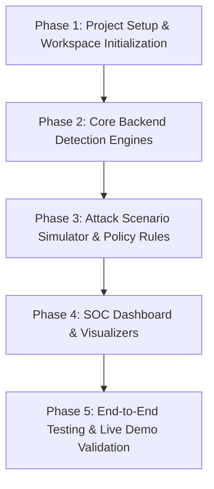

# TRINETRA: Prototype Implementation Plan

> Historical prototype reference. See [Figure 1](docs/agentic.pdf), [active phases](docs/plan.md) and [runtime](docs/runtime.md).

## 1. Prototype Objective & Scope
The objective is to deliver a functional, end-to-end prototype of **TRINETRA** (Real-Time AI Fraud Interceptor) in `/home/a9rmx_1990/hackathon/` that demonstrates the transition from reactive fraud reporting to real-time pre-settlement interception.

The prototype focuses on the three core threat vectors defined in the specification:
1. **AI Voice Clone Impersonation:** Detecting synthetic vocoder spectral artifacts during payment authorization calls.
2. **Multi-Hop Mule Ring Networks:** Detecting rapid cycle and velocity dispersion across accounts in a directed transaction graph.
3. **Coercive "Digital Arrest" Extortion:** Correlating coercive script cues with anomalous recipient accounts.

---

## 2. Architecture & Tech Stack

```
/home/a9rmx_1990/hackathon/
├── backend/
│   ├── app/
│   │   ├── main.py                # FastAPI entrypoint (REST & WebSockets)
│   │   ├── config.py              # Configuration & thresholds
│   │   ├── models/                # Pydantic schemas (Transaction, AudioPayload, RiskReport)
│   │   ├── engines/
│   │   │   ├── audio_engine.py    # Synthetic voice / LFCC & spectral anomaly detection
│   │   │   ├── graph_engine.py    # NetworkX directed graph, cycle & velocity analysis
│   │   │   └── policy_engine.py   # Unified risk scoring & dynamic friction decisions
│   │   ├── simulator/
│   │   │   └── scenarios.py       # Pre-baked attack scenarios (Voice Clone, Mule Ring, Digital Arrest)
│   │   └── samples/               # Synthetic & authentic sample audio snippets
│   ├── pyproject.toml / requirements.txt
│   └── run.sh
└── frontend/
    ├── src/
    │   ├── components/
    │   │   ├── Header.tsx         # SOC status bar & threat level
    │   │   ├── ScenarioBar.tsx    # 1-Click scenario triggers
    │   │   ├── LiveFeed.tsx       # Real-time transaction hold/allow stream
    │   │   ├── GraphView.tsx      # Interactive mule ring topology visualization
    │   │   ├── AudioInspector.tsx # Spectrogram & spectral roll-off anomaly view
    │   │   └── RiskDetail.tsx     # Breakdown: Acoustic + Graph + NLP scores
    │   ├── App.tsx
    │   └── main.tsx
    ├── package.json
    └── vite.config.ts
```

### Stack Choices
- **Backend:** Python 3 (FastAPI, WebSockets, Uvicorn, NetworkX, NumPy/SciPy/Librosa, Pydantic).
- **Frontend:** Vite + React + TypeScript + Tailwind CSS + Lucide Icons + Canvas/Cytoscape for reactive graph & spectrogram views.
- **Communication:** Sub-150ms HTTP endpoints for transaction interception + WebSockets for real-time SOC alerts.

---

## 3. Implementation Phases



### Phase 1: Workspace & Environment Setup
- Initialize `/home/a9rmx_1990/hackathon/backend` with Python virtual environment using `uv`.
- Install dependencies: `fastapi`, `uvicorn`, `networkx`, `numpy`, `scipy`, `pydantic`.
- Initialize `/home/a9rmx_1990/hackathon/frontend` using Vite + React + Tailwind.

### Phase 2: Core Backend Engines
1. **Audio Forensics Engine (`audio_engine.py`):**
   - Ingests audio streams / audio features.
   - Computes spectral roll-off, spectral flatness, and high-frequency energy distribution anomalies characteristic of neural vocoders.
   - Outputs synthetic probability score $S_{\text{acoustic}} \in [0, 100]$.
2. **Graph Intelligence Engine (`graph_engine.py`):**
   - Maintains an in-memory directed multi-graph of accounts and transactions via `NetworkX`.
   - Computes:
     - Multi-hop path length and cyclic loops.
     - Outflow dispersion velocity $V_{\text{disp}} = \frac{\sum \text{Outflow}}{\sum \text{Inflow} + \epsilon} \cdot \frac{1}{\Delta t}$.
   - Flags rapid funneling / mule layering.
   - Outputs graph threat score $S_{\text{graph}} \in [0, 100]$.
3. **Unified Risk & Decision Engine (`policy_engine.py`):**
   - Weighted aggregation: $R(T) = 0.45 \cdot S_{\text{acoustic}} + 0.40 \cdot S_{\text{graph}} + 0.15 \cdot S_{\text{nlp}}$.
   - Decision gates:
     - **Score < 35:** `ALLOW` (Instant pass-through)
     - **Score 35–69:** `STEP_UP` (Biometric / Voice Challenge required)
     - **Score ≥ 70:** `HOLD` (Automatic hold, mule account quarantined, SOC alert dispatched)

### Phase 3: Preset Demonstration Scenarios
Create deterministic, realistic scenario triggers so the prototype can be demoed effortlessly to judges:
- **Scenario A (Clean Transaction):** Typical recurring transfer to an existing counterparty. (Expected: `ALLOW`, Risk ~ 8)
- **Scenario B (CEO Voice Clone):** Wire transfer authorization call with high synthetic vocoder artifacts. (Expected: `HOLD`, Acoustic Risk ~ 94, Overall ~ 82)
- **Scenario C (5-Hop Mule Network):** Transfer heading to a newly opened node that disperses across 5 child accounts within 30 seconds. (Expected: `HOLD`, Graph Risk ~ 96, Overall ~ 88)
- **Scenario D (Digital Arrest Extortion):** Transfer paired with coercive law enforcement script and sudden savings liquidation. (Expected: `STEP_UP / HOLD`, Risk ~ 76)

### Phase 4: Interactive SOC Dashboard
- **Live Decision Stream:** Shows real-time incoming transactions with color-coded badges (`PASSED`, `VERIFICATION REQUIRED`, `INTERCEPTED & HELD`).
- **Graph Topology Visualizer:** Renders the transaction path, highlighting suspect mule hubs and cyclic laundering flows.
- **Forensic Audio Panel:** Shows live audio waveform, synthetic anomaly indicators, and frequency distribution.
- **Manual SOC Override:** Allow human analysts to click `Confirm Freeze` or `Release Hold` for realism.

### Phase 5: Verification & End-to-End Demo
- Verify latency meets sub-150ms benchmark for decisioning.
- Verify WebSocket connectivity for zero-lag SOC updates.
- Test all 4 attack feeds from the front-end simulation panel.

---

## 4. Key Deliverables & Timelines
| Deliverable | Target | Verification Method |
| :--- | :--- | :--- |
| Backend API & Engines | 1.5 - 2 hrs | Unit test runs on synthetic voice & graph cycles |
| Frontend Dashboard | 1.5 - 2 hrs | Visual inspection of interactive topology & audio canvas |
| Scenario Integration | 30 mins | 1-click execution of each attack scenario |
| Demo Polish | 30 mins | End-to-end dry run without external dependencies |
